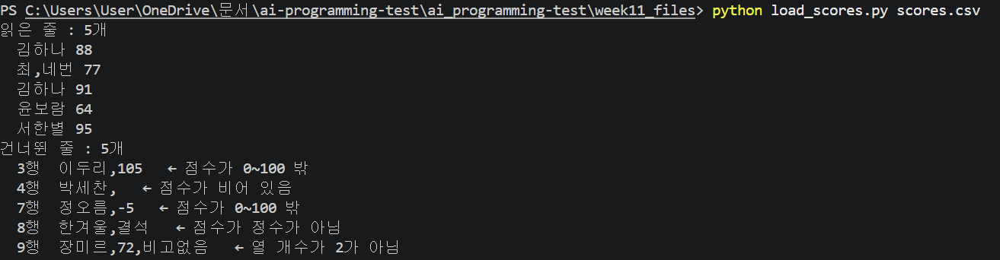
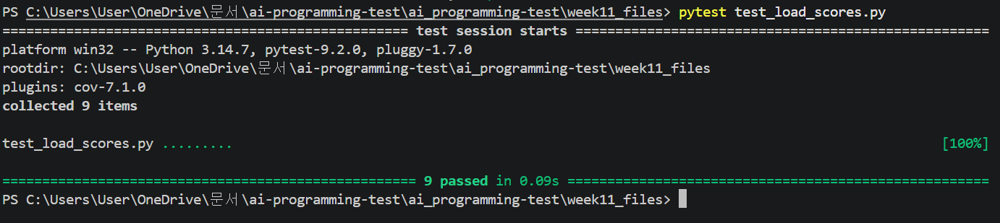

## 성적 CSV 읽기 프로그램 (load_scores)

## ① 무엇을 하나요 (What)성적 CSV 파일을 읽어 유효한 점수만 골라 내고, 건너뛴 줄은 이유와 함께 기록합니다.

## ② 왜 만들었나요 (Why) 성적파일에는 빈칸, 0~100범위 밖의 값 등 정해진 형식에서 벗어난 자료로인해 점수 기록 프로그램에 오류가 발생하고 잘못된 값을 수정하기위해 건너뛴 줄을 기록하는 프로그램이 필요 했음.

## ③ 어떻게 쓰나요 (How)
```bash
# 설치
pip install pytest pytest-cov
# 실행
cd week11_files
python load_scores.py scores.csv
```





## ④ 어떻게 테스트하나요
```bash
cd week11_files
pytest test_load_scores.py

```



## ⑤ 파일 구성
| 파일 | 하는 일 |
| --- | --- |
| load_scores.py | 적 CSV를 읽어 (유효한 목록, 건너뛴 줄 기록)을 돌려주는 함수 |
| test_load_scores.py | 직접 만든 테스트 (정상 · 예외 · 경계값) |
| empty.csv | 헤더만 있는 파일 — 빈 결과 테스트용 |
| scores.csv | 테스트용 성적 데이터 (정상 5줄 + 잘못된 줄 5줄 + 빈 줄) |
| README | 파일 설명 |

## ⑥ 만든 사람 · AI를 어디에 썼는지
- 만든 사람 :박상민 - 2026100401
- AI를 쓴 곳 : test_load_scores.py
- 내가 직접 판단한 것 :경계값

## 라이선스
MIT License (LICENSE 파일 참고)
